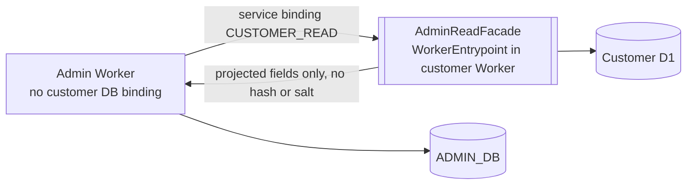

# Current architecture (as implemented on this branch)

Section 1 describes what the code does today. Section 6 describes the R2 target, which is **not implemented**. Facts below were read from the files at HEAD; the file names are the authority.

## 1. Components

```mermaid
flowchart LR
  subgraph Customer origin
    CW[Customer Worker<br/>wrangler.jsonc<br/>src/worker/index.ts]
    CA[(Customer D1 frigo-db<br/>migrations/ 41 files at 186a9cf)]
    CW --> CA
  end
  subgraph Admin origin (Access-protected in production)
    AW[Admin Worker<br/>wrangler.admin.jsonc<br/>src/worker/admin-worker.ts]
    AS[[Assets dist/admin<br/>ASSETS binding]]
    AD[(ADMIN_DB takosan-admin-db<br/>migrations-admin/0001)]
    AW --> AS
    AW --> AD
    AW -- "DB binding today (F1)" --> CA
  end
  AW -. "R2 target: service binding only" .-> FAC[[AdminReadFacade<br/>not implemented]]
  FAC -.-> CA
```

| Component | Config | Entry / code | Bindings |
|---|---|---|---|
| Customer Worker | `wrangler.jsonc` (custom domain route in file) | `src/worker/index.ts` (identical to `186a9cf`) | `DB` → `frigo-db`; assets `dist/client` |
| Admin Worker | `wrangler.admin.jsonc` | `src/worker/admin-worker.ts` | `ASSETS` → `dist/admin`; `DB` → **the same D1 database as the customer Worker** (F1); `ADMIN_DB` → `takosan-admin-db`. `workers_dev: false`; no route; placeholder all-zero IDs for ADMIN_DB and KV. |
| Local admin Worker | `wrangler.admin-local.jsonc` | same entry | `define.__ADMIN_LOCAL_AUTH__ = true`; loopback origin. Never deploy. |
| Admin SPA build | `vite.admin.config.ts` → `dist/admin` | `src/admin/**` (React, TSX) | none |

Build and deploy separation:
- `pnpm build` runs the customer web build, the admin build and the Worker type-check. `pnpm build:admin` builds only the admin bundle.
- `deploy.yml` deploys `wrangler.jsonc` only. No workflow references `wrangler.admin*.jsonc` or the admin scripts (checked by grep in this handoff).
- `ci.yml` runs lint, typecheck, `pnpm test` (which includes admin unit and integration tests), `check:migrations` (which includes the admin smoke) and build. It does **not** run the admin E2E, the workerd check or the migration matrix.

## 2. Request surface

- Document and assets: `admin-worker.ts` uses `run_worker_first: true`. `STATIC_FILE` serves hashed assets, fonts and the favicon. `SHELL_ROUTE` serves the SPA shell for `/admin/...` paths whose segments match `[A-Za-z0-9_-]` (see F10). Everything else under the admin host returns 404.
- API: `/api/v1/admin/*` (`docs/admin/API_REFERENCE.md`). Mutations require exact `Origin` and same-origin fetch metadata.
- Customer requests on the customer host never reach admin code (verified by workerd comparison, 23/23 checks, and by the customer Worker bundle being identical to `186a9cf`).

## 3. Authentication

Production intent (`ADMIN_AUTH_MODE=cloudflare_access`):
1. Cloudflare Access sits in front of the admin origin. The Worker requires a `Cf-Access-Jwt-Assertion` header on login and on every request.
2. `access.ts` verifies RS256 only, selects the key by `kid` (JWKS refresh at most once per 60 s), requires `aud` to contain `ADMIN_ACCESS_AUD`, requires the exact issuer for the team domain, checks `exp` and `nbf` with 60 s skew, and requires an `email` claim.
3. The verified email must map to an active, verified customer account with an active platform role. (Mapping by email is finding F11.)
4. The Worker creates an `admin_sessions` row and sets `__Host-takosan_admin_session` (`HttpOnly; Secure; SameSite=Strict`, host-only). The browser check confirmed these attributes under workerd.

Local mode (`ADMIN_AUTH_MODE=password`): available only when `ENVIRONMENT` is `development` or `test`, the origin is loopback, and the local define is compiled in. The production bundle does not contain the password path (verified with `wrangler deploy --dry-run` in this review).

Environment policy (`policy.ts`): unknown, empty, missing, wrong-case or `staging` environments with `ADMIN_CONSOLE_ENABLED` do not expose the console (reviewer workerd matrix, 12 negative variants × 93 checks).

Authorization: `requirePermission(...)` per route against `ADMIN_PERMISSION_MATRIX` in `src/shared/admin.ts`. Deny by default.

Sessions: revoked on logout, on role change, on credential-fingerprint change (password, email, verification or Google link), on auth-mode change, and by an admin. Absolute and idle expiry are enforced (`session-access-lifecycle` PoCs).

## 4. Data access boundaries

| Data | Store | Access today | Guard |
|---|---|---|---|
| Admin authority (roles, sessions, audit, approvals, editorial reviews, preferences) | `ADMIN_DB` | `adminDb.prepare` with fixed SQL and bound parameters | triggers (append-only audit, immutable roles, final approvals, minimum two SUPER_ADMIN) |
| Customer read model (users, households, billing, AI, recipes) | customer `DB` (`frigo-db`) through the admin Worker | `readOnlyDatabase()` wrapper in `readonly-db.ts` | **code only**: `assertReadOnlySql` (SELECT/WITH only, rejects `;` and mutating keywords), `batch`/`exec` throw. The D1 binding itself is writable (F1). |
| Credential material | customer `auth_accounts` | read on every authenticated request to compute the session fingerprint (`ACCOUNT_SQL`, `credentialFingerprint` in `auth.ts`) | none (F1) |

Pagination: `pageSize ≤ 100`, `page ≤ 1000`; list queries use `LIMIT`. Aggregates are full scans over customer tables (F7). PII is masked by default (`mask.ts`); reveal requires `users.pii.reveal` and an audit row first.

## 5. Audit

- `admin_audit_events`: append-only (no UPDATE or DELETE triggers). Mutations write their audit row in the same D1 batch as the change.
- `requireAudit` writes before a sensitive read is returned and fails closed (`503 ADMIN_AUDIT_UNAVAILABLE`).
- Not tamper-evident: an operator with D1 access can drop triggers (R1 report §12 item 6).

## 6. R2 target architecture (NOT IMPLEMENTED)



The facade exposes fixed, typed operations; the Admin Worker never composes SQL against customer data and never receives credential material. Details: `R2_IMPLEMENTATION_PLAN.md`.

## 7. Local execution

See `LOCAL_RUNBOOK.md`. Key commands: `pnpm build:admin`, `pnpm admin:preview` (Option A, in-memory synthetic fixture), `pnpm admin:local:reset -- --yes` and `pnpm admin:dev` (Option B, real workerd, loopback).
