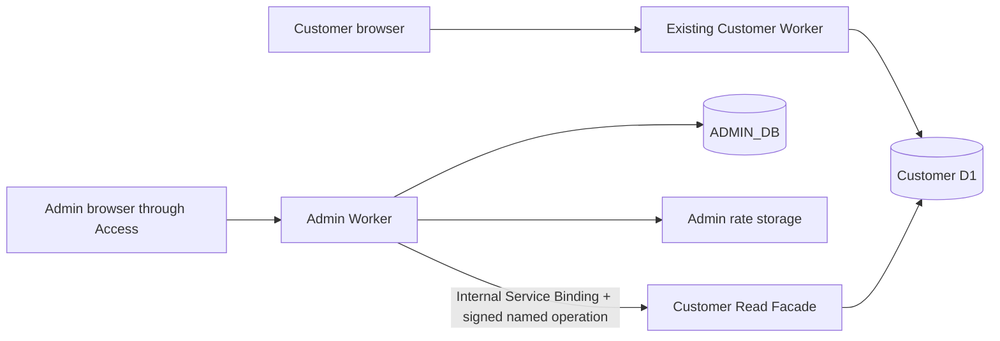

# System architecture

Runtime source: `066c35ad670bc877756150c2055e3844dd7a17ce`. Main baseline: `526596a8cd857984ad2b69901a8c7b0e9d6bccc2`.
Prepared by implementation owner `/root` (Codex); independent reviewer is
`/root/independent_admin_review`. Evidence environment: local macOS arm64,
Node 24.19.0, pnpm 10.33.2, Python 3.12.14, `TMPDIR=/private/tmp`.
Evidence timestamps are UTC. Commands, exit codes, log digests and limitations
are in `evidence/verification.json` and `12_REGRESSION_RESULTS.md`.
No live Cloudflare operation or operator approval is implied.

The existing Customer Worker retains customer authentication, household,
inventory, recipes, planning, shopping and billing authority. Its source,
customer migration ledger and release workflows are unchanged from the pinned
main baseline within the protected comparison.

Admin Worker serves the separate `dist/admin` artifact with worker-first routing.
It owns Access verification, sessions, RBAC, CSRF/Origin checks, audit, preferences,
editorial review notes, role grants and approval operations. Its only D1 binding
is `ADMIN_DB`; `CUSTOMER_READ` is an internal Service Binding to the named
`AdminCustomerReadFacade` entrypoint. No arbitrary SQL transport exists.

Facade Worker holds the customer D1 binding and exposes one RPC method, `read`,
with fifteen typed named operations. The default HTTP entrypoint always returns
404; the production template has no routes, workers.dev or preview URL. An
HMAC capability binds operation, exact validated input, actor, roles and expiry
(15 seconds). The shared secret is operator-managed and is never in source.
Input and output schemas, static SQL projections, row/query limits and serialized
output limits enforce the disclosure contract.

Admin roles and enrollment are independent of customer password hashes and
customer account lifecycle. Customer account updates are not Admin enrollment
operations. Session epoch and revocation are held in ADMIN_DB.

## Residual authority

The facade D1 binding is technically writable in the Cloudflare platform. The
source wrapper rejects writes; it cannot convert a platform D1 binding into a
read-only database capability. Facade code, dependencies, service binding
provisioning, deployment permissions and custody of its HMAC secret require
strict review. A compromised authorized Admin Worker can issue capabilities
within its code authority. Runtime data limits can refuse service on large
sources; they are not a substitute for a scalable analytics store.
