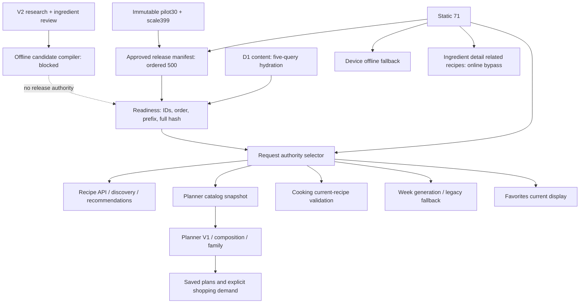

# Recipe V3 consumer map

Audit baseline: `b49f3e6c4fc2f1485b77623ed7257d0f8bd31f9a`, branch
`codex/recipe-intelligence-v3`. These are local source findings, not a live D1,
production flag, deployment, culinary approval or browser acceptance receipt.

## Authority graph

The approved local contract is `rel-bd00a4f53fcaeee4`, fingerprint
`f8cf8c7ff59df9fe29e246b9e3c9aad0fd155fa8df35bf671ac4d03fa2b5ab37`.
Static/shadow and failed-D1 fallback expose 71; verified canary/D1 can expose
500. A local manifest proves the contract, not which mode production runs.

## Consumer paths

| Flow | Current content authority and persistence | Relevant boundary / V3 requirement | Evidence |
| --- | --- | --- | --- |
| Recipe list / search | Request snapshot; matches title, description, tags, ingredient names; media added after selection | Keep stable IDs/order and shared snapshot | `src/worker/routes/recipes.ts:221`, `:228`, `:238`, `:248` |
| Recipe detail | Same request resolver; ID/slug lookup; household inventory matching; media added last | Version detail explicitly before replacing content; retain slug | `src/worker/routes/recipes.ts:253`, `:258`, `:264`, `:268` |
| Recommendations | Ranks only resolved snapshot against strict inventory | Do not import V2 or provisional identities directly | `src/worker/routes/recipes.ts:277`, `:288`, `:298` |
| Discovery / cursor | Snapshot source and fingerprint bind cursor | A source/release change rejects an incompatible cursor | `src/worker/services/recipe-discovery.ts:16`, `:25`, `:34` |
| Planner V1 generate/read | Authority-visible content; optional D1 enrichment; saved intent/result/source envelopes retain instructions and requirements | Existing results remain saved; authority/catalog drift requires explicit revalidation | `src/worker/services/meal-planning.ts:169`, `:199`, `:227`, `:249`, `:341` |
| Planner V1 regenerate/swap | Current snapshot; explicit trusted replacement and version locks | Preserve catalog/authority conflict checks; regenerate explicitly drops old locks | `src/worker/services/meal-planning.ts:694`, `:755`, `:762`, `:782` |
| Composition/manual picker | One shared authority/planner snapshot; roles filtered to visible IDs; current ID-based detail rendering | Parent authority changes block edits; component lacks historical recipe content binding | `src/worker/services/meal-composition.ts:155`, `:295`, `:345`, `:777`, `:791` |
| Family planning | Same shared snapshot; household preferences and source/version witnesses | Keep hard restrictions and transaction fences; do not infer reviewed role status from AI confidence | `src/worker/services/meal-planning.ts:355`, `:413`, `src/worker/services/meal-composition.ts:963`, `migrations/0039_meal_composition_v2.sql:61` |
| Saved recipes / favorites | User-scoped stable recipe ID; stored display includes authority identity; visible recipe refreshes display | Identity survives unavailable content; removal remains available; full historical recipe not pinned | `src/worker/routes/recipe-favorites.ts:33`, `:40`, `:65`, `:70` |
| Week read | Exact embedded saved domain response preferred | Older rows without embedded recipe use current authority; keep compatibility decoder and receipts | `src/worker/services/week-read.ts:128`, `:144`, `migrations/0045_week_swap_receipts.sql:1` |
| Week generation / swap | Current authority-visible recipes and persisted request receipts | Preserve saved response/replay semantics and household scope | `src/worker/routes/week.ts:671`, `:679`, `:768` |
| Plan-to-shopping | Trusted demand loader; exact per-component contribution snapshot; plan revision and catalog/inventory/preference witnesses | Catalog drift blocks share; existing persisted quantities are not silently rewritten by publication | `src/worker/services/shopping-plan.ts:33`, `:40`, `:56`, `:72`, `:87`, `src/worker/services/meal-composition.ts:963` |
| Shopping unknown-demand review | Exact demand/contribution fingerprint; review valid only for matching fingerprint | Retain unknown quantity and overrides; never fabricate quantity 1 | `src/worker/services/shopping-demand-review.ts:54`, `:80`, `:91`, `src/worker/services/shopping-plan.ts:100`, `:112` |
| Manual shopping attribution | Current authority validates attribution; metadata stores title; D1 FK existence checked | Keep saved title and source recipe ID; content provenance remains additive | `src/worker/routes/shopping.ts:39`, `:90`, `:92`, `:98` |
| Cooking start / active UI | Detail fetched; store holds scaled full Recipe in memory; start response has synthetic session ID | No durable server-side content token; active UI can outlive catalog publication | `src/web/pages/CookingModePage.tsx:53`, `:63`, `src/web/stores/useCookingStore.ts:69`, `src/worker/routes/recipes.ts:327`, `:351` |
| Cooking complete / history | Client freezes command/servings/explicit deductions; server independently resolves current recipe; history records ID/servings/deductions | Add content binding without modifying old request bodies or inventory authority | `src/web/stores/useCookingStore.ts:149`, `src/worker/routes/recipes.ts:380`, `:424`, `:572`, `:828` |
| Media | Current ready media attached after content selection/ranking; immutable role/version URL and hash | Media version is separate from recipe content; retain fallback, licensing and object immutability | `src/worker/services/recipe-media.ts:67`, `:79`, `src/worker/routes/recipe-media.ts:46`, `:90`, `:106` |
| Ingredient detail related recipes | Direct `ALL_RECIPES` match by ingredient ID or lowercase name | Confirmed online static71 bypass; imported429 cannot appear here | `src/web/pages/IngredientDetailPage.tsx:19`, `:212`, `:591`, `:607` |

## What is versioned today

| Persisted/held object | Existing witness | Full immutable recipe revision? | Compatibility implication |
| --- | --- | --- | --- |
| Authority snapshot | source, catalog fingerprint, load timestamp | No per-recipe content handle | Hash identifies a catalog projection, not historical row storage |
| D1 recipe | mutable `recipes.version` | No immutable content revision table | Changing current rows cannot retrieve prior content by scalar alone |
| Generated V1 plan | version1 JSON envelopes; saved requirements/instructions; source recipe versions | Saved result yes; complete immutable recipe store no | Decode old envelopes and missing authority fields; never mass rewrite |
| Composition/family component | recipe ID plus created/updated plan revision | No | Current renderer reads current title/time/content by ID |
| Week snapshot | embedded full saved response | Yes for embedded content; absent in older rows | Historical fallback must be explicit and tested |
| Favorite | recipe ID, display JSON, source/hash | No | Favorites are identity bookmarks; preserve unavailable display |
| Shopping contribution | plan/slot/component/date/recipe ID/title/quantity/unit | Exact saved demand; content version absent | Preserve old quantities and explicit share semantics |
| Active cooking | full Recipe in process memory | Temporary only | Restart/reload does not provide a durable historical revision |
| Queued cooking command | exact recipe ID/command/servings/deductions body | No | Existing body equality/idempotency checks must remain exact |
| Cooking history | recipe FK, servings, deductions, command receipts | No | Old history cannot prove which instructions were displayed |
| Media | immutable recipe/role/media-version/key/hash | Separate media version | Recipe publication must not overwrite ready media |

Evidence: `packages/recipes/src/recipe-authority.ts:31`,
`migrations/0019_recipe_domain_foundation.sql:124`,
`packages/db/src/meal-composition.ts:45`,
`migrations/0022_generated_meal_plans.sql:3`,
`packages/recipes/src/shopping-plan-snapshot.ts:33`,
`src/web/services/recipes.ts:105`, `:109`, `:171`.

Cooking risk is bounded precisely: the client freezes explicit amounts/units.
Publication does not automatically replace those amounts. The gaps are missing
content provenance, active-screen/server-current mismatch, current hard
restriction evaluation and legacy missing-unit inference by ingredient ID/name
(`src/worker/routes/recipes.ts:137`, `:339`, `:398`). Preserve FEFO, atomic inventory
commands, revision checks, private-session guards and idempotency.

## Offline and failure behavior

- Recipe detail/recommendations use static71 only after a genuine offline error;
  other API failures remain errors (`src/web/services/recipes.ts:49`, `:78`).
- Device discovery explicitly reports `device:static`, hashes static71 and binds
  cursors to that source (`src/web/services/recipe-discovery.ts:48`, `:52`, `:62`).
- Imported429 have no static device-detail fallback. This is a coverage limit,
  not permission to pretend an online D1 release is cached on the device.
- Week offline create uses static71 only in offline catch; queued requests remain
  durable and exact (`src/web/services/week.ts:82`, `:88`, `:165`).
- Queued cooking deductions/servings must not be reinterpreted or rewritten by a
  V3 upgrade (`src/web/services/recipes.ts:109`, `:171`).
- Server verified D1 snapshot TTL is 30 seconds; stale grace is five minutes.
  Invalid/expired D1 reads fall back to static71; mutation fences re-read D1 hash
  (`src/worker/services/recipe-authority.ts:114`, `:129`, `:274`).
- Service worker caches shell assets; its network/cache behavior is not evidence
  that recipe API content is durably pinned (`public/sw.js:90`, `:132`).

## Migration and acceptance obligations

1. Keep all 500 IDs/slugs, immutable approved import inputs and applied migrations.
   D1 readiness enforces an unchanged static71 prefix and full manifest hash;
   editing legacy content in place fails readiness, even with a new manifest
   (`packages/recipes/src/recipe-authority.ts:165`, `:183`, `:196`).
2. Add compatible version/snapshot binding before publishing replacement content.
   Composition intentionally has no recipe FK, avoiding catalog deletion cascades
   into user plans (`migrations/0039_meal_composition_v2.sql:26`). Favorites use
   user/recipe identity without that FK (`migrations/0042_family_meals_preferences_saved_shopping.sql:11`).
3. Verify old saved plan, old shopping demand, legacy Week row, active cooking,
   old exact queued command, rollback, unavailable favorite, catalog-switch cursor,
   imported recipe offline and media-unavailable cases using actual fixtures.
4. V2 remains research: four release blockers, no final runtime fingerprint and
   zero content-verified source URLs. Reachability/schema detection alone cannot
   certify relevance, provenance, culinary claims or production publication.
5. Cache repair/deployment acceptance remains a separate dependency. Latest local
   state records repair merged but release verification pending; live production
   flags/content/cache recovery were not observed by this audit.
