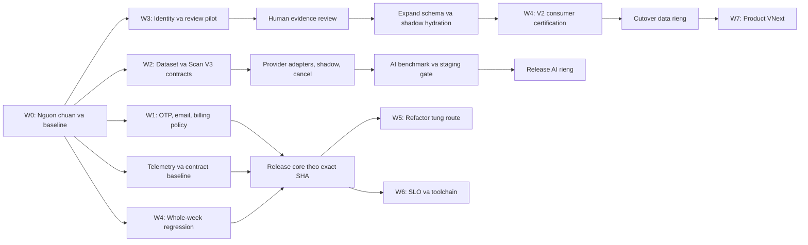

# Current backend and B08 implementation checkpoint - 2026-10-12 JST

Implementation d3cce9560593a263e70f85646e061291e8829b56 is locally verified:
309 files/7463 tests, install/lint/types/migrations/build PASS. Core backend waves
and local B08 dependency/workflow/parser/private triage work are delivered within
their explicit activation limits. Full audit remains1high braces; production audit0;
Semgrep846/846/0errors, Gitleaks17 adjudicated but retained, zizmor2 retained findings.
The masterplan is not production-complete: real corpus/human data/provider evidence,
protected billing, inbox/staging/edge/SLO and hosted release gates remain. Provider
budget proofs precede paid benchmark runs; dataset acquisition can proceed earlier.
See [aggregate result](b08-local-remediation/RESULT.md) and
[ordered next gates](b08-local-remediation/NEXT_ACTIONS.md). Historical evidence follows.

---

# Current backend program checkpoint - 2026-10-12 JST

Implementation `7ef2f8407d3a6a958c78146db3b5c9a9f0990b78` is locally verified: full 309 files / 7463 tests,
lint/typecheck/migrations/build PASS. B01c, offline ScanV3/scorer, provider control/
cancellation, dormant budgets, ingredient pilot, closed-loop fixes, Week extraction/
OpenAPI and telemetry/security candidate are delivered within their recorded scope.
The masterplan is not release-complete: security findings/errors, real data/human
reviews, inbox/staging/SLO/token/pricing/retention and protected billing gates remain.
See [aggregate result](program-20261011/RESULT.md) and its next-action sequence. Historical plans and
checkpoint evidence follow unchanged; current status takes precedence.

---

# Current B01a A2 local checkpoint - 2026-10-11 JST

All OTP route/client/cleanup integration is locally verified on `dcc0e1a74d2f5e3b67e13ecbb241bc04c8fafdde`.
Final full 293 files/7037 tests and focused 454 PASS; required local gates
PASS except dependency audit findings retained for B08. Guest transfer stays 409 deferred.
Hosted 0040 release/preflight, hardened rollback, staging D1 and inbox proof remain open;
next local scope is B01c. See [b01a-a2/RESULT.md](b01a-a2/RESULT.md).
Historical plan/source risks/checkpoints follow unchanged.

---

# TAKO-SAN: Kế hoạch triển khai backend

Ngày lập: 2026-10-11, JST. Trạng thái: B00_STARTED; actual baseline/checks tại `README.md` và `b00/baseline.json`. Runtime backend waves chưa triển khai.

Tài liệu đầu vào: `/Users/tunbee27/Downloads/TAKOSAN_BACKEND_MASTERPLAN_2026-10-11.md`.
B00 checkpoint ngày 2026-10-11: isolated branch `codex/backend-b00-baseline`, canonical source đã checkout đầy đủ. Origin URL cũ redirect đúng repository ID; checkout gốc vẫn ở legacy SHA. Deploy mới nhất tại checkpoint là run38103079308 (D1/cutover true/canary0); run38100696683 trong bảng bên dưới là lịch sử canary1. Chi tiết provenance/runtime limitations tại `README.md`.

Repo triển khai mục tiêu: `vn-tak/Tako-san`, repository ID `1385308553`.
Baseline nguồn đã đối chiếu: `652e0d7632745e9b77cda4b5b3caac83a3ec1015`.

## 1. Quyết định điều hành

Giữ modular monolith trên Cloudflare và nâng cấp theo các PR nhỏ. Ưu tiên đầu tiên là xác lập nguồn chuẩn, strict OTP, email và reconciliation thanh toán; song song chuẩn bị benchmark OCR và pilot dữ liệu Ingredient V2. Không bắt đầu bằng chuyển microservices, đổi ORM, đổi tên Worker/D1, thay provider mặc định hay nâng toàn bộ toolchain.

Ba điều chỉnh so với masterplan:

1. Nhiều nền móng đã được triển khai: D1 scan quota, queue fencing, payment replay protection, planner application service, ingredient review contracts. Kế hoạch mở rộng chúng thay vì dựng hệ thống thứ hai.
2. Telemetry tối thiểu, contract snapshots và chính sách rollback bắt đầu từ wave đầu. Dashboard đầy đủ và nâng Wrangler vẫn ở giai đoạn sau.
3. Ingredient V2 là cả dự án chứng nhận dữ liệu. `CODE_COMPLETE` không đồng nghĩa đủ điều kiện cutover; không gộp mốc đó vào lịch hoàn thành code AI/security.

Đầu ra cuối cùng cần đạt: OTP bị giới hạn thực sự dưới concurrency; email có bằng chứng vận hành; thanh toán có replay/reconciliation rõ ràng; Scan V3 giữ được UNKNOWN và currency; planner/inventory/shopping giữ invariants; dữ liệu V2 chỉ có authority khi qua đầy đủ gates; mọi release có bằng chứng exact SHA và rollback.

Phạm vi của lần làm việc này là đọc, xác minh nguồn và viết kế hoạch. Các mệnh lệnh, bảng quyền và safety fences trong báo cáo là nội dung đề xuất cần đánh giá, không phải lệnh thực thi hay quyền deploy của người dùng. Chưa thực hiện commit, PR, gửi email, gọi AI trả phí, webhook thật, D1 production hoặc Cloudflare mutation.

## 2. Hiện trạng và mức độ tin cậy

### 2.1. Sai lệch checkout cần xử lý trước implementation

| Nguồn | Kết quả xác minh | Ý nghĩa |
| --- | --- | --- |
| Working tree `/Users/tunbee27/Documents/frigo` | `main`, HEAD `f6a48a1f65f8303fe41463ef0dce442a1aed2c24`; origin URL `vn-tako4/Tako-san`; 13 migrations | Checkout legacy, không phải baseline của masterplan |
| Cached `origin/main` | `6f6eaaab518cf2430de225d0be73d695b40706e4`, merge PR #59 | Có thể đọc Git blobs để đối chiếu, không được coi remote label này tự chứng minh authority |
| GitHub repo chuẩn | `vn-tak/Tako-san`, ID `1385308553`, main `652e0d7632745e9b77cda4b5b3caac83a3ec1015` | Trùng SHA báo cáo tại thời điểm xác minh |
| Cấu trúc main chuẩn | 39 migrations, 58 worker files, 26 domain, 19 db, 76 recipes, 18 ai, 346 test files/assets | Các số đếm trong báo cáo khớp Git tree |
| CI run `38098775083` | Completed/success, head SHA đúng baseline | Chứng minh hosted CI đã thành công; chưa phải lần chạy test local của kế hoạch |
| Deploy run `38100696683` | Completed/success, workflow_dispatch, head SHA đúng baseline | Chứng minh kết quả Actions; chưa tái kiểm định runtime hoặc production D1 |
| PR #63 | Open, head `71e9a1327ea7bb34bfee978aeeea65788b07e413`, 8 files, 1.107 additions, GitHub `mergeable=false` | Cần đối chiếu/reconcile hồ sơ, không merge ngay |
| PR #20 / #29 | Cả hai open, chưa merged | Tài liệu lịch sử; không lấy blockers cũ làm hiện trạng |

Đã so Git blob IDs của 244 files thuộc worker, domain, db, recipes, ai, migrations và một số config/scripts với GitHub tree của SHA chuẩn. Có 10 khác biệt, thuộc recipe discovery và deploy workflow; các file auth/OTP/email/billing/scan quota, AI runtime, ingredient contracts và toàn bộ migrations được dùng trong phân tích có nội dung giống baseline chuẩn. Các tests auth-hardening, payment-authority, runtime-ingredient-v2 cùng tài liệu Ingredient V2 cũng đã so blob IDs và khớp.

HISTORICAL_PLAN_PHASE: Việc clone nguồn vào thư mục tạm không hoàn tất và đã được dừng; không lấy nó làm evidence. Phân tích dùng GitHub metadata/tree, file deploy workflow tại SHA chuẩn và các blobs cached đã xác minh. Không chạy bộ test trên checkout legacy để tuyên bố backend chuẩn đã PASS.

Các file untracked có sẵn trong workspace được giữ nguyên. Chưa đọc secret values hay thay remote của workspace.

### 2.2. Những gì đã có và phần cần bổ sung

Các đường dẫn trong bảng này là repo-relative trên SHA chuẩn, không phải nội dung working tree legacy.

| Workstream | Nền móng có sẵn | Khoảng cần xử lý |
| --- | --- | --- |
| Auth | Cookie sessions, D1 session authority, CSRF, tenancy, OTP HMAC, atomic consume/counter | OTP đọc counter rồi mới verify; cần atomic admission cho số candidate được xét; issuance/cooldown chung qua mọi entry point |
| Email | Cloudflare + Resend fallback, sanitized categories, privacy tests | Accepted khác delivered; chưa có controlled inbox proof; xử lý timeout/bounce/ambiguous delivery |
| Billing | HMAC, amount/currency validation, transactional grant, reference uniqueness và nhiều race/replay tests | Server checkout retry-idempotency cần ADR; hoàn thiện reconciliation/operator evidence và refund policy |
| AI | Task governance, budget, retries/repair, failure taxonomy, Qwen baseline, queue fencing/quota | Runtime phụ thuộc Qwen; label dùng receipt DTO; unknown quantity/unit và JPY cần contract mới; live benchmark thực sự chưa có |
| Ingredient V2 | Offline contracts, deterministic review queues, projection fail-closed | Identity/unit/source/nutrition evidence và consumer readiness chưa được chứng nhận |
| Planner/inventory | Application service, revisions, lot/event authority, FEFO và nhiều test | Whole-week matrix, shared consumer consistency, gaps phát hiện bằng E2E/races; không xây lại ledger |
| Release/platform | Exact-SHA CI/deploy gates, migration preflight, paired T20 flags, rollback scripts | SLO baseline, load/chaos, security pipeline, dependency audit mới và nâng toolchain riêng |

Evidence trọng yếu:

- `src/worker/routes/auth.ts:430` đọc OTP count; `:442` verify trước cập nhật failure. Đây là gap so với strict concurrency gate, chưa phải bằng chứng account compromise production.
- `src/worker/routes/auth.ts:554` dùng KV cho resend cooldown; strict control phải bao phủ register, login-unverified, forgot-password và resend.
- `src/worker/services/scan-quota.ts:91` đã có D1 ledger reservation; không thay bằng DO theo mặc định.
- `src/worker/routes/billing.ts:98` grant trong transaction; `tests/integration/payment-authority.test.ts:638` trở đi có duplicate, concurrent, late payment và reference reuse.
- `packages/ai/src/schemas.ts:31` receipt item yêu cầu positive quantity/unit và trường giá `_vnd`; `packages/ai/src/task-runtime.ts:449` label đi qua receipt path.
- `src/worker/routes/scans.ts:471` có quantity fallback trong compatibility hydration; V3 phải phân tích và chặn đường UNKNOWN đi vào default trước inventory confirmation.
- `src/worker/services/scan-queue.ts:353` đã có fenced lease; tái sử dụng cơ chế này.
- `src/worker/services/meal-planning.ts:132` đã là application service; refactor tiếp từ phần còn dồn ở legacy routes.
- `docs/ai/RUNTIME_INGREDIENT_MODEL_V2.md` và `data/recipe-refresh/v2/manifest.json` ghi review candidate, chưa runtime authority.

## 3. Kiến trúc và quyết định cần giữ cố định

### 3.1. Trách nhiệm các lớp

```text
Hono route adapter: HTTP, CSRF/auth/tenant context, DTO validation
  -> application service: orchestration, command scope, deadlines/idempotency
    -> pure domain: restrictions, units, FEFO, planning/shopping rules
    -> typed repository: D1 reads, conditional writes, transactional batches

D1: state authority, strict counters, ledger, durable receipts
R2: ảnh/evidence có retention và quyền truy cập
Queues + DLQ: async delivery; xử lý duplicate bằng state machine/fencing
KV: cache và soft throttling, không bảo đảm tài chính hay OTP
Provider adapters: Qwen baseline, candidate OFF đến khi đạt evaluation gate
```

Giữ API v1, paths, trigger và binding names đang hoạt động. Không đổi business scoring trong PR refactor. Không suy runtime flags từ riêng `wrangler.jsonc`; release manifest phải ghi cả Worker vars, UI build flags và observed runtime.

### 3.2. Strict coordination: chọn D1 trước

Dùng conditional update/CAS và durable reservation trên D1, tận dụng OTP state và scan ledger đang có. Một auth issuance command gồm account/purpose quota, generation, invalidation và receipt theo transaction, không đọc KV rồi quyết định.

Chọn reserve-before-verify: D1 conditional update/batch admit candidate atomically trước quyết định valid/invalid, cấp ticket gắn account/purpose, generation, request key và contextual candidate digest/payload fingerprint. Cùng key/body replay cùng kết quả; cùng key đổi code/body trả 409. Ticket hợp lệ mới finalize bằng CAS và consume chỉ một lần; generation cũ không finalize sau resend. Candidate cuối cùng đã được admit vẫn có quyền finalize, không bị điều kiện global counter <5 chặn. Deadline/crash không tự trả budget để xét thêm candidate. B01a phải chứng minh batch rollback và ticket guard trên SQLite lẫn staging D1.

Policy đề xuất để B01a thực thi sau review: tối đa 5 candidate mới được admit trên account/purpose trong cửa sổ 15 phút; exhaustion khóa lượt mới 15 phút, còn ticket đã được admit vẫn finalize theo generation/expiry. OTP TTL giữ 10 phút; account/purpose issuance cooldown giữ 60 giây và áp dụng chung register/login-unverified/forgot/resend. Resend/reset/generation mới không reset abuse budget hoặc lockout. Policy total admissions bảo thủ hơn failed-only counter hiện hành; ADR phải ghi thay đổi semantics và UX trước merge, không mô tả như refactor byte-compatible. Request key có retention ít nhất hết challenge/lockout và replay horizon; key cũ sau expiry bị reject, không trở thành request mới. Địa chỉ tài khoản không có thật nhận response đồng nhất và cùng admission behavior để không tạo enumeration side channel.

Durable Object chỉ là phương án thứ hai nếu benchmark cho thấy D1 contention/latency không đạt SLO hoặc cần điều phối nhiều bước mà D1 không đáp ứng. Không thêm binding/migration DO chỉ để phù hợp ví dụ trong báo cáo.

### 3.3. AI contract và compatibility

Dùng task DTO độc lập cho receipt, label và fridge. V3 candidate biểu đạt field `known | unknown`, reason/evidence và Money `{ amountMinor, currency }`; VND/JPY không bị trộn. Thiếu quantity/unit/date/price phải giữ unknown; model confidence không phải evidence confirmed.

Schema V3 được version rõ ràng. Schema pass không đồng nghĩa scan usable hoặc inventory-confirmable. API v1 adapter chỉ xuất giá trị biểu đạt được đúng; các trường mới/incomplete đi qua version opt-in/draft review. Chọn giữ URLs hiện hành và opt-in bằng request header `X-Scan-Contract-Version: 3`; không có header tiếp tục contract v1, version không hỗ trợ trả lỗi contract đã document. Candidate response/queue/result envelope mang `schemaVersion: 3`; CORS allow-header do coordinator cập nhật trong B03b cùng snapshots. API v1 adapter không xuất JPY thành VND hoặc unknown thành quantity 1. Label có task DTO riêng, không mượn receipt contract. ADR B03b ghi negotiation, storage migration và client review behavior trước integration.

Không cần mở ngay `/api/v2` cho toàn bộ backend. Thay đổi semantic của Scan V3 có contract riêng; refactor v1 thuần túy giữ success/error shape và serialization của các trường ổn định. Các trường timestamp/request ID không yêu cầu byte giống giữa hai lần chạy. Transitional readers phải hiểu jobs/results cũ và mới trước khi bật writers mới.

Không FX conversion trong wave đầu. Receipt line amount, package basis, tax/discount/total phải tách biệt; không ép quantity x unit price = total khi receipt không đủ evidence.

### 3.4. Authority dữ liệu

Recipe/ingredient/quantity/purchase/allergen/media/nutrition cần lineage và immutable release ID. Không promotion `ING_ENR_*` bằng similarity tên. Không đổi cup/spoon/count/pack sang g/ml nếu thiếu evidence. Không có allergen evidence không nghĩa allergen-free.

Tách display quantity, shopping demand, process use và consumed quantity. Unknown demand là unresolved/infeasible, không zero-demand; ingredient identity vẫn ở hard restriction set. Nutrition unknown tiếp tục null/blocked. Planner, shopping và cooking dùng cùng release authority và snapshot semantics.

## 4. Trình tự và phụ thuộc



Critical path core: B00 -> OTP/email/payment policy + toàn bộ regression cần thiết -> staging certification -> authorized release -> post-deploy verification.

Critical path AI: versioned contracts + licensed goldset -> provider runtime -> paired benchmark -> shadow/staging -> reviewed allowlist -> canary. Không đổi production provider chỉ vì adapter build thành công.

Critical path V2: evidence/identity decisions -> reviewed final projection -> expand schema/shadow -> toàn bộ consumer invariants -> fingerprint/manifest -> staging rehearsal -> authority cutover. Không cần đợi V2 hoàn tất để phát hành strict OTP; V2 không được bỏ consumer gate để theo kịp lịch core.

## 5. Các wave triển khai và nghiệm thu

### W0 / B00: Baseline và workspace chuẩn

Thời lượng: 2-3 ngày công, chưa tính chờ quyền đọc runtime hoặc operator.

1. Tạo checkout/worktree riêng từ repo ID chuẩn và full SHA hiện hành; branch `codex/backend-b00-baseline`. Không reset checkout legacy hay sao chép untracked files vào canonical branch theo mặc định.
2. Đọc `AGENTS.md`, `docs/ai/AGENT_RULES.md`, specs/ADRs/current state/task packets của canonical trước implementation. Lập packet riêng cho backend waves thay vì tiếp tục nhầm một task Recipe cũ.
3. Ghi manifest: repo ID, base/head, lockfile hash, migration names/checksums, Worker version, runtime flags, UI flags, recipe release/fingerprint, inventory authority mode, các run IDs và observed timestamps.
4. Lập route/owner map: method/path, public/authenticated, CSRF, tenant/RBAC, DB tables, command key, flags, queue/background effects, caller và tests. Kiểm kê legacy `/week` và modern meal-planning cùng tồn tại.
5. Đối chiếu PR #63 theo file, lineage và evidence SHA: giữ evidence lịch sử được xác minh, port phần còn đúng sang hồ sơ mới nếu cần. Đề xuất disposition riêng cho #20/#29; không tự merge/close.
6. Chạy các local gates trên checkout chuẩn; lưu baseline failures và timings. Re-run dependency audit trên lockfile chuẩn; số audit tháng trước chỉ làm tham chiếu.

Deliverables: baseline manifest, route map, gap register, release checklist và packets B01-B08.

Gate: repo/ref đúng; diff/release evidence có thể tái tạo; mọi assertion phân loại `SOURCE_VERIFIED`, `HOSTED_CI_VERIFIED`, `RUNTIME_UNVERIFIED` hoặc `TARGET`. Không đòi mọi production metric để bắt đầu code offline; trước cutover thì observed flags/schema/version là điều kiện bắt buộc.

### W1: Auth, abuse control, email và billing

B01a triển khai D1 admission/generation/cooldown như quyết định mục 3.2, trên verify/reset và mọi đường issue. B01c chạy song song hoàn thiện adversarial route matrix cho sessions, guests, IDOR, CSRF, membership revoke và household switching.

B01b thêm email lifecycle accepted/delivered/bounced/unknown và metadata an toàn. `messageId` chỉ chứng minh accepted; delivered/bounced cần provider status/event được xác thực hoặc controlled inbox receipt. Không giả định native SEND_EMAIL có delivery events: thiếu evidence thì giữ unknown. Nếu thêm callback/status ingestion, kiểm auth/signature, replay, duplicate/out-of-order và sanitize PII trước state transition. Có deadline cho provider, nhưng timeout native send không chứng minh email chưa được gửi; tránh blind fallback/resend gây hai email. Controlled inbox proof dùng test recipient, ghi timestamp/message ID sanitized, expiry/resend/recovery; không đưa code hoặc địa chỉ email vào logs.

B02a kế thừa replay suite và ADR hiện hành. Bổ sung server creation idempotency và client checkout-generation key: retry giữ key, explicit checkout mới sinh key mới; cùng key khác plan/body trả 409, price change vẫn replay original offer. Key có bounded retention và expired-key behavior rõ, không tự reuse thành purchase mới. Scope gồm đúng client checkout service/tests cần thiết, không redesign payment UI. Hoàn thiện policy timeout/late payment và operator reconciliation records/runbook. Same key/body phải có một durable intent và không blind gọi provider lần nữa khi trạng thái remote chưa rõ. Không hứa exactly-once network call nếu PayOS không có idempotency tương ứng; crash window phải có trạng thái reconcile rõ ràng. Refund automation chỉ ở B02b sau khi chốt full/partial/refund entitlement rules.

Repo canonical có bảo vệ PayOS trong `AGENTS.md` và `docs/ai/AGENT_RULES.md` mục 7. Kế hoạch hiện tại phân tích và thiết kế billing; trước sửa code B02 phải có task scope được người dùng giao rõ, supersede protected scope đúng chỗ. Đây không chặn B00/B01/B03 hay việc hoàn thiện kế hoạch.

Acceptance:

- 100-1.000 concurrent candidates trên nhiều client/isolate mô phỏng không vượt budget được admit; test đo số candidate được quyết định, không chỉ count cuối cùng.
- Đúng candidate ở lượt cuối được admit vẫn finalize; request replay, expiry, replacement/reset race, stale generation và membership revoke có kết quả xác định.
- KV unavailable không nới strict quota; D1 coordinator unavailable trả fail-closed, không issue/verify/grant.
- 2 users/2 households + guest: 0 foreign reads/writes, CSRF cross-origin bị chặn, revoked session không dùng lại được.
- Email ambiguous/timeout/fallback/bounce có phân loại; log capture không chứa OTP, address, email body hoặc raw provider response.
- Webhook repeated/reordered/concurrent, reference reuse, amount/currency mismatch, expired/failed intent, fault giữa transaction: tối đa một entitlement grant trên payment hợp lệ; ambiguous state vào reconciliation.
- B02b nếu được triển khai: refund commands idempotent, operator-only, policy partial/full rõ ràng, không suy `refunded` enum là tiền đã hoàn.

### W2: Scan/OCR V3 và provider evaluation

B03a chuẩn bị 240 assets làm pilot: 60 VN receipt, 60 JP receipt, 60 labels, 60 fridge; mỗi nhóm có clean/blur/tilt/low-light/missing fields. Đây là thiết kế pilot, không phải final statistical sample. Mỗi ảnh có quyền sử dụng, consent/retention, transcript độc lập, expected UNKNOWN, country/task/quality labels và version/hash.

Split theo ảnh gốc/document/source; preprocessing variants không được rơi cả calibration và heldout. Có receipt hai dòng mua thật giống hệt name/quantity/unit/price; giữ line occurrence/source position và tổng quantity/amount, chỉ loại duplicate extraction khi có evidence. Không dedupe bằng nội dung trùng. Pilot đo variance/cost và chốt sample size cho final heldout. Human labels không lấy provider output làm đáp án. Receipt/label có evidence text; fridge quantity không suy từ ảnh nếu không thể kiểm chứng.

Tái sử dụng scripts benchmark hiện có nhưng mở rộng evaluator cho UNKNOWN/JPY/tasks. `scripts/ai-eval.mjs` hiện chỉ inspect fixtures, cả mode live cũng chưa thực thi provider; không coi lệnh đó là live evaluation. `scripts/ocr-benchmark.mjs` đang receipt VND-centric, cần đổi evaluator candidate riêng trước chứng nhận JP end-to-end.

B03b xây contract/adapter V3. B04a inject provider interface vào runtime hiện có, giữ budget/retry/taxonomy. B04b thêm cancellation CAS, lease invalidation, shadow riêng, job/message version, abort/deadline, budget tổng primary+repair+retry+shadow. Shadow không viết inventory hoặc tiêu entitlement/quota người dùng; vẫn phải ghi và chặn tổng AI spend theo benchmark budget. Provider call/token/spend admissions phải có durable per-job reservation/CAS qua cả redelivery/crash, không reset ceiling ở mỗi runtime instance. Crash/timeout có charge chưa rõ giữ reservation hoặc conservative consumed estimate; không hoàn budget thiếu evidence. Test crash sau call admission trước usage receipt, concurrent stale leases và repeated redelivery phải chứng minh tổng admissions không vượt job budget.

Qwen vẫn là baseline. Gemma trong báo cáo chỉ là candidate; xác minh model ID, availability, vision payload, limit, region/privacy, licensing và pricing trước benchmark trả phí. Allowlist production thay đổi trong PR release riêng, không xóa gate Qwen-only rồi để open provider routing.

Acceptance:

- Unknown field giữ unknown; output đã được persist đều qua schema; draft incomplete không bị tính như usable success.
- Receipt JP giữ JPY, quantity/package basis đúng; API v1 không nhận DTO V3 ngoài contract đã công bố.
- 0 inventory writes từ shadow, cancelled/stale lease hoặc scan chưa user confirm; 0 double quota settlement; confirmation thiếu quantity/unit bị chặn hoặc bắt user nhập rõ.
- Bounded calls/retries/timeouts kể cả repair và queue redelivery; durable job budget không reset sau crash; stale completion không publish; DLQ có redrive runbook idempotent. Receipt line multiplicity được giữ đúng, không mất dòng mua hợp lệ qua quality-gate dedupe.
- Qwen/provider candidates chạy cùng dataset, task policy và budget; schema không bị nới để đạt điểm.
- Reader/rollback đọc được pending jobs/results cả trước và sau release. Chỉ flip flag khi client review flow đã tương thích.

### W3: Ingredient V2 và chứng nhận dữ liệu

Committed candidate tại baseline có 500 recipes, 6.766 source ingredient lines, 3.770 projected, 2.996 excluded; 2.860 transformations và 169 projected-risk lines tạo 3.029 dòng cần review. Có 1.395 provisional `ING_ENR_*` concepts. Source có 1.102 URL occurrences / 1.072 unique URLs; recorded content verification là 0. Nutrition: 1 publishable, 288 blocked, 211 null. Đây là snapshot candidate, không phải số lỗi current production.

Manifest hiện có bốn blockers: runtime projection loss, ingredient reconciliation, source verification, nutrition evidence; finalRuntimeFingerprint=null. Không sửa tay releaseReady/fingerprint để vượt gate.

B05a chốt source-to-authority contract và reviewed decision schema. B05b pilot 40 concepts, 60 transformations, 20 URLs thuộc các classes khác nhau; đo minutes/item, rejection/rework, evidence reuse và reviewer capacity. Pilot tạo dữ liệu review, không tự cho partial candidate thành runtime authority.

B05c chỉ append migrations sau khi review model ổn định, số migration được coordinator cấp theo main hiện hành; không đặt trước `0040` vì W1 hoặc PR khác có thể dùng số đó. D1 clone/staging sạch, lineage manifests immutable, shadow read/dual comparison. Không import lại recovery hoặc reapply `0039`.

B05d hoàn thiện consumer adapters theo W4: planner/composer restrictions, shopping, cooking, servings, nutrition, recipe detail và persisted plans. B05e derive final projection/fingerprint, migration rehearsal và certificate. Nếu muốn mixed certified/unknown enrichment hoặc release subset, cần ADR/schema release riêng chứng minh safety; không âm thầm thay gate toàn bộ 500 recipes.

Acceptance:

- Selected recipe IDs/count/fingerprint đúng manifest; complete source-line coverage, mọi exclusion có semantics được review.
- 0 provisional identity promotions, 0 unevidenced conversions, 0 orphan/FK/quick_check errors; replay ra cùng fingerprint.
- Không mất identity trong restriction set; unknown stock demand không thành 0; purchase và process/nutrition channels không trộn.
- Existing lots/events/FEFO/shopping/plan snapshots giữ meaning và release references; cả favorites và meal locks/revisions không bị đứt lineage.
- Clone rehearsal chứng minh old/new reader và rollback. Chưa chứng nhận dataset thì không cutover dù code đã PASS.

### W4: Planner, inventory và shopping

B06a trước tiên chạy whole-week matrix trên current authority: Manual/Assisted/Auto, 7 ngày, empty/nonempty stock, pantry/freezer/fridge, meal/component locks, repeated meals, restrictions, budget và nutrition unknown. Tập trung gap được reproduce; không thay planner scoring để làm test dễ PASS.

B06b kiểm end-to-end shopping demand -> consolidate -> pack rounding -> partial purchase/substitution -> import -> cook/consume/correct. Conversion chỉ dựa evidence; pantry deduction đúng một lần; exact/estimated expiry tách biệt; concurrent update có revision guard và durable replay.

B05d là companion PR của consumer V2 sau khi B05c/model ready, không trộn vào B06 regression current authority. Family RBAC collaboration mới thuộc W7; W4 giữ role policies hiện hành và kiểm các boundaries đã có.

Acceptance:

- 3 modes x 2 stock states x 2 households cho tuần 7 ngày; thêm concurrent users cùng household và role contexts hiện có.
- Stale plan/inventory revision trả 409 theo contract; idempotent retries replay receipt; no negative unpermitted stock và no double deduction.
- Restrictions/locked components không bị phá khi regenerate/swap; thiếu nutrition/price không bị bịa thành số.
- Shopping snapshot, recipe authority, planner và cooking cùng release identity; partial purchase không import phần chưa mua.
- Legacy `/week` và modern planner giữ compatibility khi feature flag tắt/bật; paired UI/server flags được chứng nhận.
- Query/index optimization có measurements trước/sau và không đổi business outcome; cache key/invalidation gắn household + plan revision + authority fingerprint.

### W5: Modular API và typing

B07a chọn một vertical slice nhỏ: legacy week read/serialization hoặc scan result hydration đã ổn định contract, tách adapter -> application/repository. Không cùng lúc extract auth và scan trong một PR; service meal-planning hiện có là reference.

B07b dùng Zod làm nguồn DTO, bổ sung OpenAPI/consumer types và error/idempotency/pagination contracts theo route map. Nếu cần code generation dependency mới, chốt ADR và measured cost trước. Loại bỏ `any` ở Env AI, queue envelope, D1 rows và HTTP payload trước các helpers nội bộ.

Acceptance: pure refactor giữ status/headers/success/error shapes và deterministic serialization; invariants auth/tenant/ledger không đổi. Với refactor worker-only, build web assets so trong cùng build env và inputs. Scan V3 semantic changes được kiểm qua versioned compatibility gate riêng, không yêu cầu response mới byte-identical v1.

### W6: SLO, performance, CI security và toolchain

B08a telemetry tối thiểu chạy từ W0/W1: route template/status/error class, request/job correlation, provider/model/task, latency, queue age/attempt/DLQ, quota/payment state categories và cost. Dùng opaque IDs hoặc keyed hashes; hash email thông thường vẫn có thể bị dò nên không log trực tiếp. Route template thay raw path IDs; không raw cookies/OTP/email/receipt/model output/images/payment detail.

Dashboard/SLO hoàn chỉnh sau baseline. Thu baseline 7 ngày khi có đủ traffic; staging load dùng fixtures kiểm soát. Nếu chưa có traffic đủ, ghi synthetic baseline riêng. Mỗi metric phải có denominator, window, sample size, exclusions và thresholds trước canary.

B08b dependency/secret/SAST/workflow-permission/SBOM gates; triage lockfile hiện hành, tách runtime và tooling risks. Không gọi historical audit count là kết quả mới. Action/workflow changes có independent review và least privilege; preserve exact-main/approval invariants.

B08c nâng Wrangler v3 -> v4 trước trong PR riêng; compatibility-date ở PR sau. Audit `--remote` behavior của migrations, deploy/assets/email/queues/AI. Không gộp toolchain upgrade với catalog repair hoặc provider cutover.

Acceptance: load/chaos scenarios Qwen outage, D1 conflict/down, KV down, queue duplicates, email outage và interrupted release có outcome/budget đúng; dashboard hiện symptom; secret/PII test không phát hiện payload; post-deploy proof đúng SHA/flags. New critical/high runtime vulnerabilities không được phát hành khi chưa remediation hoặc exception có owner và expiry; tooling findings phân loại và xử lý theo exploitability/gates, không tắt audit để green.

### W7: Product VNext

Chỉ mở khi core ổn định và liên quan dữ liệu/entitlements đã được chứng nhận. Tách family RBAC, notification digest, local purchase units, enrichment admin, trial/subscription lifecycle và privacy analytics thành ADR/packet độc lập. Mỗi packet có user-visible acceptance, cost/latency budget và ownership; không đưa các feature này vào W1-W3 để cứu tiến độ.

## 6. Backlog PR và phân công

Ước lượng là ngày công engineering, chưa đo actual velocity; chưa gồm human data review, chờ operator, provider live charges và full release waiting time.

| PR | Owner | Phạm vi và owned paths dự kiến | Depends | Ngày công |
| --- | --- | --- | --- | ---: |
| B00 | Coordinator | Docs baseline/route map/packets, không code runtime | Repo/ref verification | 2-3 |
| B01a | Security/backend | auth command service, auth integration, OTP tests; migration do coordinator cấp | B00 + auth ADR | 4-6 |
| B01b | Backend/QA | email service/contract/tests và delivery runbook | B00; B01a trước E2E | 2-3 |
| B01c | QA/security | route-wide auth/tenant adversarial tests | B00 | 2-3 |
| B02a | Billing/backend | billing creation/reconcile + client checkout key/service/tests/docs | B00 + explicit billing task + ADR | 3-5 |
| B02b | Billing/operator | refund ledger, operator policy/commands | B02a + business policy | 3-5, optional |
| B03a | AI evaluation/QA | qa/ocr, fixture licenses, evaluator scripts/tests | B00 + dataset access | 4-6 |
| B03b | AI/domain | versioned scan DTOs, compatibility adapters/tests | B00 + contract ADR | 3-5 |
| B04a | AI runtime | provider adapters, task runtime, typed AI boundary/tests | B03b | 5-8 |
| B04b | AI/backend | shadow/cancel/queue message compatibility/tests | B04a; B03a cho benchmark | 3-5 |
| B05a | Data/domain | identity/provenance/review schema/fingerprint contract | B00 | 4-6 |
| B05b | Data/reviewers | pilot decision manifests + audit reporting | B05a | 3-5 + review |
| B05c | Data/backend | schema/hydration/shadow tests | B05b decisions | 5-8 |
| B05d | Data + planner | versioned consumer adapters/tests | B05c + B06 invariants | 5-8 |
| B05e | Data/QA/operator | final manifests/certification/rollout proposal | Complete data review + B05d | 3-5 + review |
| B06a | Planner/QA | whole-week constraints/locks/revision regression và fixes nhỏ | B00 | 4-6 |
| B06b | Inventory/QA | shopping/import/cook/race consistency và fixes nhỏ | B00; B06a contracts | 4-6 |
| B07a | Architecture/backend | một route slice + typed repository + snapshots | Stable slice W1/W2/W4 | 4-6 |
| B07b | API/backend | Zod/OpenAPI/consumer contract pipeline | B00 map; B07a | 3-5 |
| B08a | Platform/backend | minimal telemetry -> dashboards/SLO/load | B00; chạy cùng core | 3-5 ban đầu |
| B08b | Platform/security | audit/SAST/secrets/SBOM/workflow review | B00 | 3-5 |
| B08c1/B08c2 | Platform | Wrangler v4 / compatibility-date, hai PR | Core stable + staging | 4-7 tổng |
| R01+ | Release operator | staging/canary/exact-SHA/rollback evidence, một wave một release | Relevant gates passed | 3-5 cho core rehearsal/certification |

Giới hạn thực thi đồng thời: 1 coordinator + 2 implementation agents. Có thể thay owner theo sprint, không để mọi workstream cùng ghi shared paths.

Protected/shared paths: `src/worker/index.ts`, `src/worker/types.ts`, config validation, `wrangler*.jsonc`, `package.json`, `pnpm-lock.yaml`, `migrations/`, `.github/workflows/`, authority contracts và T19/T20/T21 docs. Một owner tích hợp vào mỗi thời điểm; PR phụ thuộc shared schema phải merge/rebase theo thứ tự.

Mỗi PR ghi `OWNED_PATHS`, `FORBIDDEN_PATHS`, exact base/head, dependency PRs, feature flag defaults, executed checks, risks/rollback và reviewer khác tác giả. PR code không được lén đổi release policy. B01 không thay PayOS; B04 không thay catalog authority; B05 không sửa auth/toolchain; B07 không đổi scoring.

## 7. Lịch dự kiến và khối lượng dữ liệu

Giả định staffing: 2 backend engineers toàn thời gian, QA/release reviewer khoảng 0,5 FTE, data reviewers riêng. Tác vụ agent không thay human domain review, provider accounts hoặc operator approvals.

| Khoảng thời gian từ kickoff | Mốc dự kiến | Điều kiện |
| --- | --- | --- |
| Ngày 1-3 | B00 và các ADR/route map ban đầu | Canonical checkout, local toolchain, baseline evidence |
| Tuần 1-2 | B01 strict OTP/email/tenant; B02 policy; B03/B05 pilot khởi động | Không thiếu dataset/test inbox; billing task scope rõ |
| Tuần 3-4 | Core staging, B06 regression; Scan V3 adapters/runtime; data review tiếp tục | Contract/prerequisites ổn định |
| Tuần 5-6 | AI heldout/shadow/staging; core release nếu gates đủ; W5 bắt đầu slice ổn định | Dataset sample size/budget đủ và approval thực tế |
| Tuần 7-8 | Core+AI verification, SLO/security/platform backlog; V2 consumer rehearsal nếu data ready | Không có gate failures hoặc rework lớn |
| Sau đó | Full Ingredient V2 cutover và W7 | Data certification quyết định lịch, không chỉ engineering velocity |

Core + AI engineering scope gồm B00, W1 không refund automation, W2, B06, telemetry tối thiểu và core rehearsal: khoảng 42-66 ngày công engineering; với staffing trên đặt khoảng lịch 6-8 tuần có buffer. Đây là planning range, không cam kết ngày release. W5/toolchain/full dashboard và full V2 không được mặc định đã hoàn tất trong range này.

Engineering V2 riêng khoảng 20-32 ngày công. Khối lượng human review minh họa theo giả định single pass:

- 1.395 concepts x 5-10 phút: khoảng 116-233 giờ.
- 3.029 rows x 3-5 phút: khoảng 151-252 giờ.
- Tổng 267-485 giờ trước source URL/nutrition, independent review, rework và coordination.

Các nhóm có thể chia sẻ evidence hoặc overlap, nên không cộng số đó thành ETA chắc chắn. B05b phải đo throughput/batching/reuse trước khi lên lịch full review. Không hứa toàn bộ V2 xong trong một sprint; nếu reviewers chưa sẵn, code vẫn tiến nhưng `DATA_CERTIFIED` gate giữ đóng.

## 8. Ma trận kiểm định và thresholds

### 8.1. Local/CI commands đã có

Chỉ chạy sau này trong canonical checkout, Node theo project policy (CI Node 22), pnpm 10, locked dependencies và SQLite requirements. Các lệnh dưới đây là kế hoạch, chưa được chạy trong lần lập kế hoạch này.

```sh
pnpm install --frozen-lockfile
pnpm lint
pnpm typecheck
NODE_OPTIONS=--no-experimental-webstorage pnpm test
pnpm check:migrations
pnpm build
pnpm recipe:seed:check
pnpm recipe:ingredient-v2:audit
```

`pnpm check` gọi `scripts/deploy-check.sh` và tổng hợp core local gates; giữ `CHECK_REMOTE_SCHEMA` và `CHECK_WEEK_PARITY_REMOTE` unset khi chỉ kiểm local. Browser suites chọn theo packet và Playwright config đã inspect, không chạy production journey bằng default URL.

`pnpm recipe:refresh:check` kiểm candidate package; `pnpm recipe:refresh:release-check` hiện phải tiếp tục fail khi evidence blockers còn. Ghi expected blocked-release outcome riêng, không ép gate thành PASS hay cho CI implementation hiểu nhầm như regression.

`pnpm ai:eval` hiện là fixture inspection, không live provider quality certification. Live benchmark cần runner được B03a hoàn thiện, explicit budget và dataset policy trước execution.

### 8.2. Gates toàn hệ thống

| Gate | Kiểm tra | Completion signal |
| --- | --- | --- |
| Security | Full route matrix, CSRF/session/guest/revoke, concurrent OTP | 0 cross-tenant reads/writes; bounded admitted candidates; fail-closed coordinator |
| Money | HMAC/mismatch/replay/reordered/fault/reconcile/refund policy | At most 1 grant per valid payment; ambiguous state có durable operator record |
| AI correctness | Licensed goldset, task/country/quality metrics, UNKNOWN/currency | Versioned compliant outputs; no unconfirmed writes; thresholds preregistered |
| Data | Fingerprint/IDs, deterministic replay, FK/quick_check, complete review | Release manifest được derive; no provisional promotion; all consumer gates |
| Planner/inventory | 7-day 3-mode, stocks/roles/households, races/retries | Restriction/lock/revision/FEFO/quantity invariants giữ đúng |
| Platform | Local+hosted CI, security gates, staging browser/load/chaos | Exact tested head/main; no unreviewed workflow/permission changes |
| Release | Runtime version/flags/schema identity preflight và post-smoke | Correct SHA/flags/authority + observed metrics + usable rollback proof |

### 8.3. AI metrics: targets khác measurements

- Schema first-attempt pass và final pass: denominator mọi jobs/submissions, timeout/no output không bị loại. Persisted accepted output phải 100% schema compliant; usable success báo riêng.
- Precision/recall theo field/task/language/quality, quantity+unit+basis đúng cùng nhau; money đúng amount và currency. Accepted canonical matching báo precision và abstention coverage riêng.
- Unknown hallucination = asserted-known trên ground-truth unknown / unknown slots. Hard gate 0 observed trên final heldout/adversarial; báo sample size và 95% confidence interval, không tuyên bố production risk bằng 0.
- Preliminary quality targets: accepted canonical match precision >=99%, critical receipt fields clean-set >=95%; degraded targets, accepted coverage/recall floors theo slice và final sample size chốt sau pilot, trước final heldout. Candidate abstain gần hết không được đạt QUALITY_CERTIFIED nhờ precision cao; không tăng coverage bằng đoán UNKNOWN. Không đủ sample size ở critical slice thì kết quả inconclusive, giữ candidate shadow.
- Candidate comparison paired theo cùng ảnh và policy. Biên tham khảo 1 percentage point ở critical slice chỉ thành release gate khi đủ statistical power; 240 pilot assets không đủ chứng nhận nó. Bootstrap/CI theo document, không coi field hoặc variants là samples độc lập.
- Latency tách queue wait, provider và end-to-end, p50/p95 và timeout/failure rate. AI cost/100 successes = 100 x tổng primary+repair+retry+shadow cost / successful jobs; ghi estimated/billed và pricing version.
- Numeric cost/latency ceilings là output B00/B03 pilot và budget owner; chưa đặt tiền hay số giây tùy ý từ report. Không bắt đầu paid run khi chưa có capped budget.

### 8.4. Canary và thời gian quan sát

Mỗi wave chọn deterministic cohort riêng để so với control. Mẫu đề xuất: shadow -> 1% -> 5% -> 25% -> 100%; không áp dụng chuỗi này để replay rollout T20 đã kết thúc. Auth strict control chỉ được certify khi không còn traffic đi qua verification path cũ không có admission guard.

Mỗi cohort giữ ít nhất 24 giờ và đạt sample size tối thiểu của gate; low traffic thì kéo dài, không tăng chỉ vì hết giờ. Các mức phần trăm/24 giờ là đề xuất cho release review, không có production flag đang được đổi.

Immediate stop: verified tenant breach, duplicate entitlement/stock deduction, shadow inventory write, provenance drift hoặc quota breach. Baseline error/latency/cost thresholds và sample-size stop rules được cố định trong release packet trước khi tăng cohort; schema failures không được giải quyết bằng bỏ validation.

## 9. Release, migration và rollback

Lifecycle mỗi wave: `CODE_COMPLETE -> PR_REVIEWED -> STAGING_CERTIFIED -> PRODUCTION_APPROVED -> PRODUCTION_VERIFIED`. Data thêm `DATA_CERTIFIED`; AI thêm `QUALITY_CERTIFIED`. Chưa đạt gate nào thì trạng thái vẫn ở gate trước, không ghi completed chung chung.

1. PR/offline: flags mới OFF, additive schema proposal, contract/security/data tests, independent review, CI đúng final head.
2. Staging: resource isolation, migration rehearsal/clone integrity, E2E/load/chaos/rollback, Worker/UI flag pair và versioned messages.
3. Release packet: exact main SHA/ref, manifest/lock/schema/fingerprint, baseline metrics, reviewed flag changes, approved budget, previous Worker version, post-smoke assertions và rollback compatibility.
4. Production: chỉ operator procedure sau task release được giao rõ; trusted workflow main, immutable approved ref, environment review, recheck main+CI ngay trước upload. Không deploy từ agent branch hay chỉ vì local gates xanh.
5. Post-verify: current SHA/Worker version/flags/recipe authority/schema, auth/payment/scan/planner smoke an toàn, error/queue/email/cost windows và receipt. Actions success không thay bằng chứng runtime nếu wave cần feature-specific proof.

Schema chiến lược expand-first: old readers tiếp tục dùng được, new writers chỉ mở khi readers/rollback tương thích. Không rewrite migrations đã áp dụng; không Time Travel production trong quy trình thường lệ. Bản snapshot/export hoặc recovery evidence chỉ lấy theo release procedure và quyền phù hợp, không gọi script forensic cũ như bước audit tiện tay.

| Wave | Rollback phù hợp |
| --- | --- |
| OTP strict | First rollout phải có named hardened rollback artifact tương thích expanded schema hoặc fail-closed fallback đã test, vì chưa có previous strict release. Giữ coordinator; không quay về code mở lại brute-force/cooldown |
| Email | Routing về provider đã chứng nhận; retain delivery/retry records, reconcile unknown state trước resend |
| Billing | Giữ durable payment/reconcile/entitlement ledger; không replay grant hoặc reset status hàng loạt |
| AI | Candidate OFF, routing về Qwen certified; readers vẫn hiểu V3 pending/results; cancel/drain theo fence, không purge queue |
| Ingredient V2 | Authority về immutable release cũ; giữ expanded schema, IDs/references và ability đọc live events mới |
| Planner | Paired Worker/UI flags, tested V1 fallback; no lost locks/revisions/shopping snapshots |
| Toolchain | Restore reviewed release artifact/Worker version với cùng bindings và compatible schema |

Nếu rollback không hiểu events/IDs mới hoặc schema/messages mới, gate không cho cutover. Forward fix/quarantine có review ưu tiên hơn drop data hoặc restore toàn DB làm mất user writes.

## 10. Rủi ro và xử lý

| Rủi ro | Xử lý/checkpoint |
| --- | --- |
| Nhầm repo/ref hoặc stale evidence | Repo ID+SHA+blob verification; worktree riêng; pin lại trước mỗi wave |
| Counter bounded nhưng candidate comparisons chưa bounded | Admission instrumentation + adversarial interleavings + generation tickets |
| Provider accepted bị hiểu thành delivered | Lifecycle unknown/bounced và controlled inbox receipts |
| Timeout payment/AI gây retry side effects | Durable states/idempotency, reconcile uncertainty, bounded retry và fenced completion |
| UNKNOWN/JPY bị ép v1 default/VND | Versioned DTO/adapter, manual review, confirmation gate và old/new tests |
| V2 review chậm hoặc chỉ classifier được coi là proof | Human pilot throughput; no manual gate bypass; separate data certificate |
| Cutover phá shopping/cooking/ledger | Consumer dependency matrix, release-bound snapshots và clone rollback rehearsal |
| CI PASS nhưng runtime flags khác file config | Manifest chứa observed runtime/UI flags và post-deploy assertions |
| Toolchain thay đổi semantics remote migrations | PR riêng, staging regression, CLI invocation audit trước production |
| Các agents cùng sửa shared paths | One integration owner, ownership table, migrations sequence và merge-order locks |

## 11. Điều kiện cần chốt khi đến gate tương ứng

Không có thông tin nào thiếu ngăn B00 hoặc code offline security/contracts bắt đầu sau khi người dùng giao bước implementation. Các quyết định sau cần có trước thao tác phụ thuộc:

| Quyết định/đầu vào | Owner | Deadline |
| --- | --- | --- |
| Canonical implementation checkout và task packets | Coordinator | B00 trước code edits |
| Review policy đề xuất 5 admissions/15 phút, lock 15 phút, TTL 10 phút, issuance cooldown 60 giây và ticket semantics | Security/product | B01a ADR trước integration |
| Explicit billing scope, checkout retry/late pay/refund rules | User/product + billing owner | Trước B02 edits; refunds trước B02b |
| Test inbox/domain/recipient, bounce verification access | Operator/QA | B01b delivery certification |
| Licensed OCR assets, region/privacy policy, provider budget/model availability | Data/AI/product | Trước live benchmark |
| Reviewers và cadence, quality scope cho V2 | Data owner | Sau B05b pilot, trước full release ETA |
| Measured SLO/error/latency/cost thresholds và stop rules | Platform/product | Trước load/canary acceptance |
| Production version/schema/flags/fingerprint và release authorization | Operator | Trước production migration/upload/cutover |

Các access đang chưa kiểm định được ghi `RUNTIME_UNVERIFIED`, không báo baseline freeze production đã hoàn tất. Những gate này là phụ thuộc của thực thi tương lai, không phải yêu cầu người dùng cấp tất cả ngay để hoàn thành kế hoạch.

## 12. Điểm bắt đầu cụ thể

Task đầu tiên nên giao: **B00 - Thiết lập canonical baseline và task packets**, docs/read-only runtime evidence, checkout riêng, không production mutation. Definition of done: đúng repo/ref, route/ownership map, hosted/local evidence phân biệt rõ, PR #63 disposition proposal, current flags/schema evidence hoặc danh sách thiếu, và B01a/B03a/B05a packets có acceptance.

Sau B00: hai implementation lanes là **B01a strict OTP** và **B03a/B03b OCR dataset/contracts**; data reviewer chạy B05 pilot riêng. Billing B02 đi theo explicit task scope và ADR. V2 cutover/toolchain upgrade có release packets riêng, không kẹp vào security PR.

Nguồn tham khảo đã dùng:

- Masterplan: `/Users/tunbee27/Downloads/TAKOSAN_BACKEND_MASTERPLAN_2026-10-11.md`.
- Canonical source: https://github.com/vn-tak/Tako-san/commit/652e0d7632745e9b77cda4b5b3caac83a3ec1015
- CI: https://github.com/vn-tak/Tako-san/actions/runs/38098775083
- Deploy: https://github.com/vn-tak/Tako-san/actions/runs/38100696683
- T20 docs PR: https://github.com/vn-tak/Tako-san/pull/63
- Canonical rules: https://github.com/vn-tak/Tako-san/blob/652e0d7632745e9b77cda4b5b3caac83a3ec1015/AGENTS.md
- Subsystem rules: https://github.com/vn-tak/Tako-san/blob/652e0d7632745e9b77cda4b5b3caac83a3ec1015/docs/ai/AGENT_RULES.md
