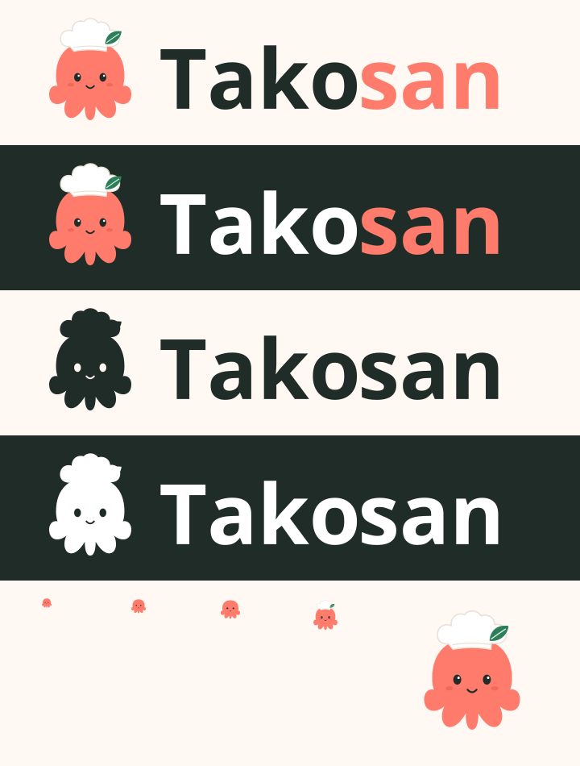

# Takosan V3 - Visual QA

Các screenshot đến từ production build thật, Chromium 153, locale vi-VN,
reduced motion, dữ liệu SQLite synthetic và network provider bị chặn.
Không sử dụng concept để giả screenshot; không tuyên bố kiểm tra độc lập.

## Coverage

BEFORE baseline và AFTER đều có 198 lượt render: 33 states x
320/375/390/768/1024/1440px. Chiều cao 844px trên mobile, 1000px ở tablet/desktop.
Observations ghi requested/rendered route, viewport, heading, font, logo bounds,
scrollWidth, ảnh, clipping navigation và axe WCAG 2/2.1/2.2 AA.

33 states: landing, login, register, verify-missing, onboarding household/preferences/
goals, home, fridge, scan, photo review, receipt review, discovery, detail,
planner empty/setup, shopping, profile/preferences/household, app/planning/notification/
privacy settings, inbox, Plus, cooking, nutrition tab, ingredient detail, saved weekly
plan, daily planned home, planned meal, plan shopping/budget.

AFTER: không horizontal overflow, ảnh hỏng, navigation clipping, heading-count
hoặc axe violations. Logo giữ aspect ratio. Hai journeys kiểm keyboard home link
(focus outline >=2px) và logout dialog Escape/focus-return.

Bổ sung: text 200% ở 320/768px trên Home/Fridge/Recipes/Settings; short screen
390x420 trên bốn trang đó; inventory lỗi/loading thật qua local fault/delay;
cooking review và successful local inventory confirmation. Week flag-off empty/setup
ở đủ sáu width; PWA cached landing offline ở 390px. Không chứng nhận native zoom,
real device notch, iOS/Safari/Android launcher hoặc screen-reader thủ công.

## BEFORE / AFTER

Representative screenshots và observations được lưu tại `evidence`.
Full-resolution gallery local được xuất cùng báo cáo bàn giao.

| Trang | BEFORE | AFTER |
| --- | --- | --- |
| Home 320 | [trước](evidence/before/home-320.png) | [sau](evidence/after/home-320.png) |
| Home 375 | [trước](evidence/before/home-375.png) | [sau](evidence/after/home-375.png) |
| Home 390 | [trước](evidence/before/home-390.png) | [sau](evidence/after/home-390.png) |
| Home 768 | [trước](evidence/before/home-768.png) | [sau](evidence/after/home-768.png) |
| Home 1024 | [trước](evidence/before/home-1024.png) | [sau](evidence/after/home-1024.png) |
| Home 1440 | [trước](evidence/before/home-1440.png) | [sau](evidence/after/home-1440.png) |
| Landing 1440 | [trước](evidence/before/landing-1440.png) | [sau](evidence/after/landing-1440.png) |
| Login 375 | [trước](evidence/before/login-375.png) | [sau](evidence/after/login-375.png) |
| Scan review 320 | [trước](evidence/before/scan-review-320.png) | [sau](evidence/after/scan-review-320.png) |
| Weekly plan 1024 | [trước](evidence/before/saved-weekly-plan-1024.png) | [sau](evidence/after/saved-weekly-plan-1024.png) |
| Cooking 390 | [trước](evidence/before/cooking-390.png) | [sau](evidence/after/cooking-390.png) |
| Planned meal 390 | [trước](evidence/before/planned-meal-390.png) | [sau](evidence/after/planned-meal-390.png) |

## Lỗi phát hiện và xử lý

1. Leaf Green chữ nhỏ trên Mint/tint chỉ 4,28-4,34:1. Sửa thành derived semantic
   text-on-soft; tính toán 5,61-5,68:1 và axe matrix chạy lại không lỗi.
2. PNG maskable giữ channel alpha dù SVG nền opaque. Flatten khi xuất; test opacity/
   kích thước/safe circle đã đạt.
3. Harness chờ ảnh một lần trước khi query render thêm lazy images; có false findings.
   Sửa readiness chờ query/DOM/network và đặt eager trong predicate. Không sửa ảnh
   sản phẩm; full matrix mới không ảnh hỏng.
4. Switching build folder giữa hai flags làm test state dùng hashed chunk đã cũ.
   Đóng băng root build cho QA; chạy lại trên immutable copied build.
5. Self-review thấy tagline textContent mất dấu cách ở line break; thêm khoảng trắng.
   Không đổi bố cục, kiểm lại focused tests/build và matrix.

## Self-review

Codex xem trực tiếp screenshot đại diện BEFORE/AFTER, logo variants, OG và icons.
Logo mới đọc rõ hơn; primary CTA thống nhất green, coral có vai trò accent, phần
nội dung/chức năng giữ hierarchy và navigation hiện tại. Mascot chỉ xuất ở logo,
feedback phù hợp và Plus illustration; không biến màn hình thành poster.
Kiểm footer/bottom nav, text wrapping, modal keyboard, recipe tabs, các trạng thái
unknown/empty/error. Không có lỗi branding nghiêm trọng còn tái hiện trong coverage.

Authentication/provider/config chưa khả dụng được ghi đúng trên login; không dùng
screenshot local để khẳng định Google login hoặc OTP giao nhận thực tế đã chứng nhận.
