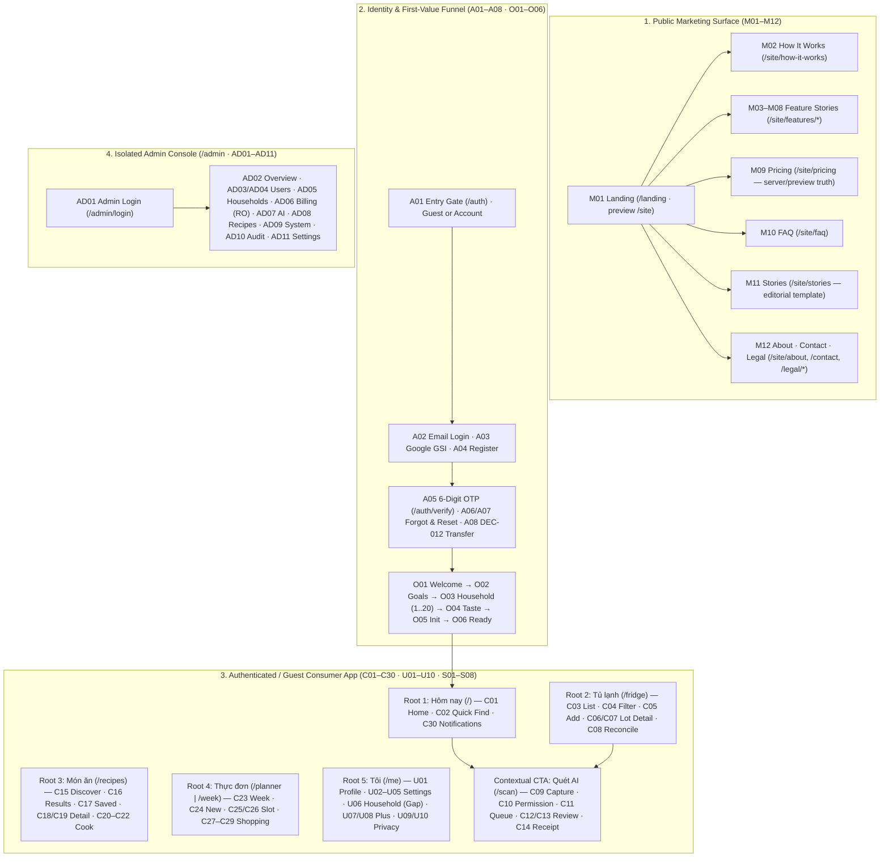

# UX_ARCHITECTURE_G01.md — Canonical Sitemap, 9 Journeys & Responsive Workbench Spec

- **Gate:** `G01` (UX Architecture & Journey Mapping)
- **Source Baseline:** `87f279a055e028336ea334cc51c7ab4224f30ef4` (`hello-tako/Takolio`)
- **Design North Star:** Closed-loop Vietnamese smart kitchen assistant — *"Bữa ngon, nhẹ đầu — từ những gì sẵn có"* (`Tồn kho → Xác định nhu cầu → Khám phá món → Lên lịch → Mua thiếu → Nấu → Xác nhận đã dùng → Cập nhật tồn kho`).

---

## 1. Information Architecture & Domain Separation (`DDR-001`)

---

## 2. Mobile 5-Root + Contextual Scan vs Desktop Workbench Contract

| Breakpoint | Shell Pattern | Module Adaptation (Never "Stretched Mobile") |
| :--- | :--- | :--- |
| **Mobile (`320px`, `390×844`, `428×926`)** | Top contextual bar (`56px`) + Single-column content + Fixed **5-Root Bottom Nav** (`Hôm nay`, `Tủ lạnh`, `Món ăn`, `Thực đơn`, `Tôi`, `>=44×44px` targets, safe-area inset). **Scan** appears as prominent contextual CTA on `Hôm nay` & `Tủ lạnh`, never a cramped 6th root. | Stacked priority cards (`1:3:6` hierarchy), bottom sheets for filters/quick-edit, sticky non-overlapping step bar in Cooking (`C21`). |
| **Tablet (`768×1024`, `1024×768`)** | `80px` left icon+label rail + contextual header Scan CTA. | 2-column recipe discovery grid, split scan source + editable review list (`C12/C14`), multi-day planner strip. |
| **Desktop (`1440×900`, `1920×1080`)** | `248px` persistent left Studio Sidebar (`BrandLockup` + Quick Search `C02` + 5 Roots + Contextual `Quét nguyên liệu` button) + `max-w-[1200px]` workbench container. | **Home (`C01`)**: 8-col primary meal/recommendations + 4-col FEFO use-soon & quick-action rail. **Fridge (`C03`)**: filter/summary bar + structured lot table/split inspector. **Recipe Detail (`C18`)**: 5-col sticky media & serving/availability summary + 7-col ingredients & step method. **Planner (`C23`)**: 7-day horizontal/grid workbench calendar + net shopping sidebar. **Admin (`AD02`)**: data-dense metric cards, health checklist, incident feed & telemetry bars. |

---

## 3. Canonical URL & Legacy Alias Preservation Matrix

| Canonical Path | Preserved Aliases / Redirects | State / Query Ownership |
| :--- | :--- | :--- |
| `/` (`C01`) | — | Authenticated/onboarded Home; unauthenticated redirects to `/landing` until `DDR-001` cutover |
| `/landing` (`M01`) + `/site/*` (`M01–M12` preview) | Preserves `/landing` entry gate | Public marketing preview without hijacking authenticated `/` |
| `/auth` (`A01–A04, A06–A08`), `/auth/verify` (`A05`) | `?mode=login\|register\|forgot`, `?provider=google`, `?returnTo=/...` | Sanitized internal-only `returnTo`; tab-scoped OTP verify context |
| `/onboarding/*` (`O01–O06`) | `/onboarding/welcome`, `/onboarding/goals`, `/onboarding/household`, `/onboarding/preferences`, `/onboarding/start`, `/onboarding/ready` | Server `POST /api/v1/onboarding` remains sole completion authority |
| `/fridge` (`C03–C05`), `/fridge/:id` (`C06–C07`) | `/inventory`, `/inventory/:id`, `/ingredients/:id` | `?q=&category=&sort=` synced in URL; `If-Match` version concurrency |
| `/recipes` (`C15–C17`), `/recipes/:slug` (`C18–C19`) | `/recipes/id/:id` | `?q=&view=saved&servings=&region=` preserved across Back/Forward |
| `/cook/:slug` (`C20–C21`), `/cooking/complete` (`C22`) | `/cooking/:id` | Immersive shell; explicit completion required before single stock deduction |
| `/planner` (`C23–C26`, `C29`) | `/week`, `/week/setup`, `/week/generating`, `/week/:planId`, `/week/:planId/meal/:mealId`, `/week/:planId/shopping` | Bidirectional compatibility under `isMealPlannerEnabled()` ON and OFF |

---

## 4. Specification of All 9 Critical End-to-End Journeys (`J01–J09`)

1. **`J01` Public → Auth → Onboarding → First Value**: `M01` CTA → `A01/A04` Register → `A05` 6-digit OTP → `O01–O06` (Goals, Household `1..20`, Preferences) → `POST /api/v1/onboarding` ack → `C01` Home with immediate first-value action.
2. **`J02` Guest → Add Stock → Account Upgrade (`DEC-012`)**: Guest starts on `M01` → adds item in `C05` → upgrades in `A04/A02` → handles transfer success or explicit `A08` server transfer-deferred state with zero cross-account cache leak.
3. **`J03` Fridge → Scan → Human Review → Stock Update**: `C01/C03` → `C09` Scan (or `C10` upload fallback) → `C11` queued/analyzing → `C12` edit low-confidence rows → explicit `Confirm` → `C13` server ack → `C03` updated stock.
4. **`J04` Stock → Quantity-Aware Discovery → Cook → Single Deduction**: `C15` filter → `C18/C19` scale servings & inspect unit-aware availability → `C20/C21` step-by-step timer → `C22` confirm actual used quantities → single idempotent inventory deduction.
5. **`J05` Weekly Planner → Swap → Net Shopping → Import**: `C24` create plan → `C23` inspect week → `C25/C26` preview delta & swap meal → `C27/C28` net shopping list → `C29` server-confirmed stock import (zero double-import).
6. **`J06` Saved & URL-Filtered Discovery**: `C15/C16/C17` apply query/region/saved view → open `C18` → browser Back restores exact URL params and filter pills; guest sees honest sign-in prompt for server favorites where applicable.
7. **`J07` Offline Outbox & `409` Version Conflict**: `S04` offline banner & `pendingSync` indicator → concurrent external update triggers `409` → `S05 / C08` reloads authoritative revision without silent data loss; outbox fenced per `userId:householdId`.
8. **`J08` Free → Takolio Plus Read-Only Presentation**: `U07` displays live `GET /api/v1/billing/plans` & `/billing/account` truth; `U08` PayOS checkout/webhook code remains 100% untouched in protected red zone.
9. **`J09` Admin Console RBAC & Operational Telemetry**: `AD01` isolated admin login → `AD02–AD11` permission-gated views (`401/403` enforced), synthetic fixture banner when in local preview, PII redacted, `AD06` billing strictly read-only.
